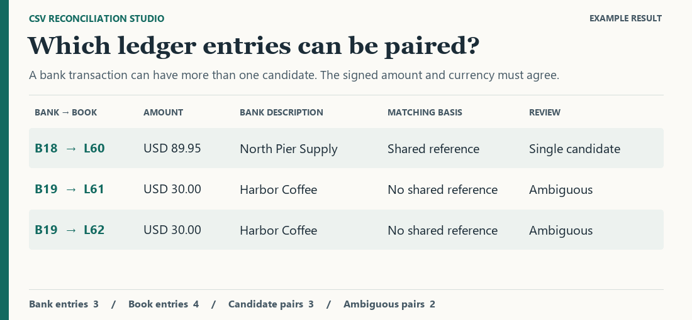
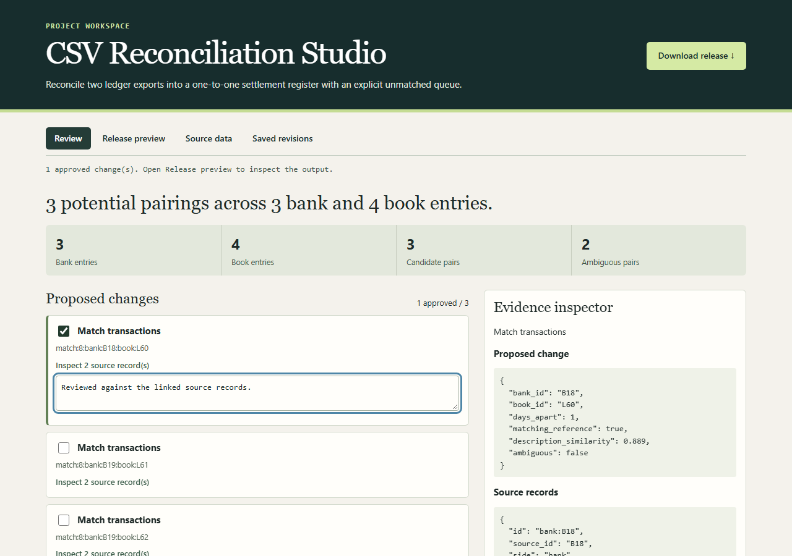

# CSV Reconciliation Studio

Reconcile two ledger exports into a one-to-one settlement register with an explicit unmatched queue.

[](https://github.com/oguzhanozfe/csv-reconciliation-studio/actions/workflows/check.yml) · [Deploy to Render](https://render.com/deploy?repo=https://github.com/oguzhanozfe/csv-reconciliation-studio) · [Input guide](GUIDE.md)

Two ledgers agree on an amount but disagree about which payment it belongs to. Compare the dates and references, approve one pairing, and retain the remaining entries for follow-up.



## Try it

With Python 3.11+ installed, clone this repository and run:

```sh
git clone https://github.com/oguzhanozfe/csv-reconciliation-studio.git
cd csv-reconciliation-studio
python app.py
```

Open <http://127.0.0.1:8000>. The synthetic example is loaded. Select a proposed change, inspect its source records, and open **Release preview** to see the resulting files. Choose **Download release** to save them.

## Walk through the example

Paste a bank CSV and a book CSV into the two string fields. Each uses id, date, currency, amount, reference and description columns. IDs are unique within a source. Dates use ISO calendar notation. Signed amounts must already use the same debit/credit convention in both exports. Amounts have up to two decimal places; currencies are never converted.

**What the engine finds.** 3 potential pairings across 3 bank and 4 book entries.

**Try this decision.** Approve **Match transactions**. The [example review](docs/example-review.json) lists the supporting record IDs and the checksum of each exported file. Its native outputs are [`reconciled.csv`](docs/example-release/reconciled.csv), [`unmatched.csv`](docs/example-release/unmatched.csv).

Reproduce that release at the command line:

```sh
python app.py analyze example.json
python app.py export example.json --approve "match:8:bank:B18:book:L60" --out reviewed.zip
```

## Model-assisted review

With a local model in Ollama or LM Studio, Azure OpenAI, Amazon Bedrock, or a compatible API connected, select **Request suggestions**. The model examines up to eight candidate actions. Each displayed suggestion links to one of that action's source records. Approving a change and recording a review note remain explicit reviewer actions.

The app runs locally with Python's standard library. The Docker image includes the Bedrock SDK and the production web server. The same UI can save immutable revisions, reopen a workspace and compare decisions. See [model settings, Docker deployment and the HTTP API](docs/deployment.md).



## Development

The domain algorithm and exporter live in [pipeline.py](pipeline.py). The [method guide](GUIDE.md) describes its input assumptions and limitations. Install test dependencies and run the suite:

```sh
python -m pip install -r requirements.txt
python -m unittest discover -v
```

[MIT license](LICENSE)
